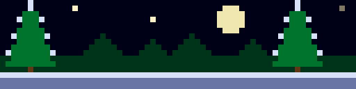

# led-matrix – Surplife LED matrix 64×16 without the app

🇩🇪 [Deutsche Fassung](README.md)

An alternative to the **Surplife app**: a Raspberry Pi uploads your own animations via Bluetooth
to a Surplife LED matrix (64×16 pixels, device name `IOTBT…`), rotates them on a schedule,
switches the display on and off by time of day and adapts the brightness to daylight. Around 70
hand-drawn (procedurally generated) Christmas, winter and New Year animations are included.

**Related projects** this builds on:

- [ge0rg/surplife-curtain](https://codeberg.org/ge0rg/surplife-curtain) – protocol of the
  Surplife LED curtain; this matrix speaks the same protocol.
- [lambdafu/surplife](https://github.com/lambdafu/surplife) – the "a2pl" image compression
  (`pi/a2pl.py` is taken from there, MIT license).
- [dsalaj/surplife-matrix-ble](https://github.com/dsalaj/surplife-matrix-ble) – control of the
  90×12 panels; the 64×16 matrix does not understand their upload commands, though.

Code comments and most identifiers are in German.


---

## Contents

1. [Features](#features)
2. [Hardware](#hardware)
3. [Quick start](#quick-start)
4. [How it works](#how-it-works)
5. [Configuration](#configuration)
6. [Rotation plan](#rotation-plan)
7. [Animations](#animations)
8. [Your own animations](#your-own-animations)
9. [Preparing the next season](#preparing-the-next-season)
10. [Matrix protocol](#matrix-protocol)
11. [Limits and pitfalls](#limits-and-pitfalls)
12. [Troubleshooting](#troubleshooting)
13. [Programs](#programs)
14. [Tests](#tests)
15. [License](#license)

---

## Features

- **Upload without the app** – GIF (64×16) → matrix. The matrix stores the animation and plays it
  by itself, even after a power cut.
- **Watchdog service** (`matrix-waechter`) – looks for the matrix every 30 s and uploads only when
  something changed (animation, speed, brightness); retries with growing pauses on errors.
- **Scheduled rotation** – animations in phases (before Advent, Advent weeks, Christmas, New
  Year's Eve), a change every 30 minutes; a planner places animations only at times the matrix is
  on. A phase can start to the second (New Year greeting just before midnight).
- **On/off schedule** – mornings and from half an hour before sunset (computed for your
  location), extra windows (New Year's Eve until 1 am) and an end of season. Switched via an
  **optional smart plug** or, without a plug, **via Bluetooth** (display on/off).
- **Daylight brightness** – bright between sunrise and shortly after sunset, dimmed otherwise.
- **Advent calendar** – regenerated every night ("NOCH 31 TAGE BIS WEIHNACHTEN" = 31 days to go).
- **Dates and year numbers computed automatically** – Advent Sundays, New Year's Eve, the greeting
  with the right year.
- **Pre-compressed cache** – an upload is then just connect + transfer (15–40 s depending on size).
- **Demo mode** – many animations in a row over a single connection.

## Hardware

| Part | Notes |
|---|---|
| Surplife LED matrix 64×16 | Bluetooth name `IOTBT…`, control box with a button |
| Raspberry Pi | tested: Pi 4 with Raspberry Pi OS (Debian 12), BlueZ, Python 3.11 |
| Smart plug (**optional**) | switchable via HTTP: `GET http://<ip>/ein` (on) and `/aus` (off); its start page contains a line `PIN Status : … ein|aus` |

**Bluetooth reception** – on the Pi 4, Wi-Fi and Bluetooth share chip and antenna:

- Put Wi-Fi on **5 GHz** (on 2.4 GHz connecting failed dozens of times):
  `nmcli con modify <connection> 802-11-wireless.band a`
- The antenna sits on the board edge next to the USB-C port – turn that edge towards the matrix
  or its control box (6 dB better in our test). Keep it away from metal.
- Aim for a signal better than about −90 dBm; −85 dBm and better is comfortable.

## Quick start

1. Install Raspberry Pi OS, enable SSH, preferably 5 GHz Wi-Fi.
2. Copy the repository to the Pi and install:
   ```bash
   git clone https://github.com/<account>/led-matrix.git
   cd led-matrix/pi && sudo ./installieren.sh
   ```
   The script updates packages, creates `/opt/matrix` with a Python environment (bleak, Pillow),
   installs programs, animations and systemd services, generates the Advent calendar and scans
   for the matrix. Log: `/opt/matrix/einrichtung.log`.
3. **Close the Surplife app** – the matrix accepts only one connection.
4. Adjust settings: `sudo nano /etc/default/matrix-waechter` (at least your location, see
   [Configuration](#configuration); the plug only if you have one).
5. Test upload:
   ```bash
   cd /opt/matrix && .venv/bin/python matrix_upload.py gifs/schneemann_64x16.gif
   ```
6. Enable the services:
   ```bash
   sudo systemctl enable --now matrix-waechter
   sudo systemctl enable --now matrix-zeitplan.timer   # only needed with a smart plug
   ```
   Follow the log: `journalctl -u matrix-waechter -f`

## How it works

```
            every 30 s                   on change
 Watchdog ──────────────► find matrix ──────────────► connect → upload → remember
    │                         │
    │  plan: which GIF?       │  without plug: display on/off by schedule (Bluetooth)
    │  brightness: day/night  │
    ▼                         ▼
 /etc/default/matrix-waechter      /var/lib/matrix-waechter/stand (what is stored)

 Schedule timer (every minute, only with a plug): target state → plug on/off
 Advent calendar timer (00:05): generate and compress today's calendar
```

- The **state file** (`/var/lib/matrix-waechter/stand`) holds the matrix name, a checksum of the
  GIF, speed and brightness. If the target differs, it uploads – otherwise not. The matrix memory
  is written only on real changes.
- **Restart via the plug** (if present): after three failed uploads in a row, the watchdog cuts
  power for 10 s, at most once every 15 minutes.
- **Phase start** with seconds: the watchdog wakes up early, finds the matrix and waits for the
  exact second before uploading.

## Configuration

Almost everything lives in `/etc/default/matrix-waechter` (template: `pi/matrix-waechter.default`).
After changes:

- **Schedule values** (`MATRIX_ZEITPLAN_…`, location, end): the schedule timer re-reads them every
  minute; still restart the watchdog so the Bluetooth switching picks them up.
- **Everything else**: `sudo systemctl restart matrix-waechter`.

| What | Variable(s) | Example / meaning |
|---|---|---|
| Matrix name | `MATRIX_NAME` | `IOTBT1A2`; empty = first matrix found |
| **Morning hours** | `MATRIX_ZEITPLAN_MORGEN` | `06:30-08:30`; empty = off in the morning |
| **Evening hours** | `MATRIX_ZEITPLAN_ABEND_VOR`, `MATRIX_ZEITPLAN_ABEND_BIS` | `30` (minutes before sunset) until `21:30`; empty `ABEND_BIS` = off in the evening |
| Special days | `MATRIX_ZEITPLAN_EXTRA` | `2026-12-31T21:30/2027-01-01T01:00` – additionally on; separate several with spaces |
| End of season | `MATRIX_ENDE` | `2027-01-01 01:00` – afterwards the display stays off and the watchdog idles |
| **Location** | `MATRIX_BREITE`, `MATRIX_LAENGE`, `MATRIX_ZEITZONE` | latitude/longitude in degrees, e.g. `47.995` / `7.849`, `Europe/Berlin` |
| Daylight brightness | `MATRIX_HELL_TAG`, `MATRIX_HELL_NACHT`, `MATRIX_HELL_NACH_UNTERGANG` | `100` / `67` / `30` (minutes after sunset it dims) |
| Fixed brightness | `MATRIX_HELL` | `67` – used when `MATRIX_HELL_TAG` is empty |
| Speed | `MATRIX_TEMPO` | `75` (1–75, the app's value) |
| Smart plug (optional) | `MATRIX_STECKDOSE` | `http://192.0.2.10`; empty = none (then Bluetooth switching) |
| Restart via plug | `MATRIX_NEUSTART_NACH`, `MATRIX_AUS_SEKUNDEN`, `MATRIX_NEUSTART_ABSTAND` | `3` failures, `10` s off, at most every `900` s |
| Size limit | `MATRIX_MAX_BYTES` | `78000` – larger animations are not uploaded (see [Limits](#limits-and-pitfalls)) |
| Scanning | `MATRIX_SCAN_ABSTAND`, `MATRIX_PAUSE_MAX` | `30` s between scans, up to `600` s after errors |
| Rotation plan | `MATRIX_GIF_WECHSEL`, `MATRIX_GIFS…` | generated by the planner, see [Rotation plan](#rotation-plan) |

**Check the schedule** (sun times, on-times and brightness for the next days):

```bash
set -a; . /etc/default/matrix-waechter; set +a
python3 /opt/matrix/matrix_zeitplan.py plan 7
```

**Examples**

- On longer in the evening, until 22:30: `MATRIX_ZEITPLAN_ABEND_BIS=22:30`
- Not at all in the morning: `MATRIX_ZEITPLAN_MORGEN=`
- Always full brightness: `MATRIX_HELL_TAG=` and `MATRIX_HELL=100`
- New Year's Eve until 2 am: `MATRIX_ZEITPLAN_EXTRA="2026-12-31T21:30/2027-01-01T02:00"` and
  `MATRIX_ENDE="2027-01-01 02:00"`

If you change the operating hours a lot, also regenerate the [rotation plan](#rotation-plan) – it
places animations only at times the matrix is on.

### Without a smart plug

The plug is **optional**. Without it (`MATRIX_STECKDOSE=` empty):

- Uploading, rotation and brightness work the same.
- The watchdog switches the **display via Bluetooth** on the same schedule (`71 23` / `71 24`).
  The animation stays stored, only the LEDs go dark. As connecting already switches the display on,
  it switches it off again after an upload outside operating hours. Manually:
  `matrix_anzeige.py an|aus` (stop the watchdog first).
- Only the power restart for a hung matrix is missing.
- `matrix-zeitplan.timer` is not needed (it does nothing without a plug).

## Rotation plan

`pi/plan_erzeugen.py` decides which animation runs when:

- one slot per half hour, phases with their own start:
  1. one week before the first Advent Sunday – general winter animations,
  2. to 5. four Advent weeks – each with the matching Advent wreath (Sunday morning and every full
     hour on Sunday evening, Wednesday and Friday 6 pm), Advent calendar daily at 5 pm, St Nicholas
     on 6 December,
  6. from 25 December – animations with Christmas greetings,
  7. from 27 December – New Year's Eve (on 31 December fireworks at 11 pm, countdown at 11:30 pm),
  8. on 31 December at 23:59:18 – New Year greeting, timed to the second so it runs at midnight;
- animations only on slots where the matrix is on; never twice in a row;
- Advent Sundays, New Year's Eve, end of season and extra window are computed from the year.

```bash
python3 pi/plan_erzeugen.py            # writes the plan into pi/matrix-waechter.default
python3 pi/plan_erzeugen.py --zeigen   # shows what runs when
```

Then replace the lines `MATRIX_GIF_WECHSEL`, `MATRIX_GIFS…`, `MATRIX_ZEITPLAN_EXTRA` and
`MATRIX_ENDE` in `/etc/default/matrix-waechter` and restart the watchdog. Lists, fixed slots and
the interval are at the top of `plan_erzeugen.py` (`ALLGEMEIN`, `ADVENT_EXTRA`, `WEIHNACHTEN`,
`SILVESTER`, `fest()`, `SCHRITT`).

## Animations

All 64×16, 255 frames each, at most 76 KB compressed; 8× enlarged previews in `vorschau/`.

| Animation | Group | Content | KB |
|---|---|---|---|
| `kamin` | Winter | fireplace, stockings, snowy window, tree | 71.7 |
| `schlittenflug` | Winter | Santa's sleigh over the village, presents drop into chimneys | 73.5 |
| `polarlicht` | Winter | northern lights over mountains and a cabin | 72.6 |
| `lebkuchen` | Winter | gingerbread house, icicle, gingerbread man, candy canes | 74.0 |
| `zug` | Winter | Christmas train with steam engine, tree, presents and snowman | 73.7 |
| `glocken` | Winter | swinging bells, notes, scrolling song title | 70.8 |
| `pinguine` | Winter | penguins with hats, belly slide, snowball | 73.5 |
| `rentier` | Winter | Rudolph with glowing nose | 73.7 |
| `schneeflocken` | Winter | growing, rotating ice crystals | 73.6 |
| `eislaufen` | Winter | ice skaters, lanterns, fairy lights | 73.5 |
| `weihnachtsmarkt` | Winter | market stalls, carousel, mulled wine, people | 73.1 |
| `lichterhaus` | Winter | house decorated light by light, light-up reindeer | 72.5 |
| `baum_schmuecken` | Winter | tree gets lights, baubles, tinsel, star | 73.3 |
| `schneeballschlacht` | Winter | snowball fight, snow angels | 67.4 |
| `rodeln` | Winter | children sledding | 73.1 |
| `futterhaus` | Winter | birds at the feeder | 73.2 |
| `winterwald` | Winter | deer and fox in the winter forest | 72.9 |
| `bratapfel` | Winter | baked apple, cocoa with cream and marshmallows | 73.2 |
| `stadt_schnee` | Winter | town turns white, windows light up | 73.5 |
| `skifahrer` | Winter | skier in a slalom, chairlift going up | 70.1 |
| `schneepflug` | Winter | snowplough clears the street at night | 73.4 |
| `schneekugel` | Winter | snow globe being shaken | 72.7 |
| `hundeschlitten` | Winter | husky team pulls the sled through the snow | 73.6 |
| `eisbaer` | Winter | polar bear mother and cub on an ice floe | 65.4 |
| `iglu` | Winter | igloo is built, the light goes on inside | 54.9 |
| `eule` | Winter | snowy owl glides through the winter night | 73.7 |
| `schneemann_bauen` | Winter | children build a snowman | 73.1 |
| `kuckucksuhr` | Winter | Black Forest cuckoo clock | 70.8 |
| `schwibbogen` | Winter | candle arch in the window, the lights come on | 72.5 |
| `nussknacker` | Winter | nutcracker cracks nuts | 71.7 |
| `schwarzwald` | Winter | winter in the Black Forest (with lettering) | 73.5 |
| `katze_baum` | Winter | cat plays with the Christmas tree | 71.1 |
| `pyramide` | Winter | Christmas pyramid turning in candlelight | 71.5 |
| `raeuchermann` | Winter | incense smoker puffs smoke rings | 73.8 |
| `gluecksschwein` | Silvester | lucky pig dances in the confetti | 70.6 |
| `rakete` | Silvester | rockets launch from bottles | 53.9 |
| `kirchturm` | Silvester | church clock strikes midnight | 72.3 |
| `wunderkerzen` | Silvester | sparklers draw in the night | 57.4 |
| `weihnachtsmann_kamin` | Winter | Santa stuck in the chimney | 70.2 |
| `kirschtorte` | Winter | Black Forest cake | 54.4 |
| `hermelin` | Winter | stoat in the snow | 55.7 |
| `muehle` | Winter | Black Forest mill in winter | 73.9 |
| `weihnachtsmann_rentier` | Winter | Santa and reindeer (50 frames) | 9.0 |
| `auspacken` | Presents | unwrapping a present: teddy, toy train, star | 47.7 |
| `werkstatt` | Presents | elves at the conveyor belt | 71.5 |
| `geschenkeberg` | Presents | presents pile up under the tree | 70.1 |
| `wunschzettel` | Presents | wish letters fly to the North Pole mailbox | 70.5 |
| `plaetzchen` | Presents | baking and decorating cookies | 68.9 |
| `advent1` | Advent | Advent wreath, week 1 | 63.2 |
| `advent2` | Advent | Advent wreath, week 2 | 67.7 |
| `advent3` | Advent | Advent wreath, week 3 | 69.3 |
| `advent4` | Advent | Advent wreath, week 4 | 65.9 |
| `adventskalender` | Advent | calendar door with days until Christmas Eve – regenerated daily | 65.5 |
| `nikolaus` | Advent | St Nicholas fills the boots (6 Dec) | 73.1 |
| `krippe` | Christmas | star of Bethlehem, stable, three kings | 73.4 |
| `hirten` | Christmas | shepherds, angel, star | 72.1 |
| `stille_nacht` | Christmas | child in the manger, candles | 71.8 |
| `weihnacht_bunt` | Christmas | trees, Christmas greeting, presents (from 25 Dec) | 66.1 |
| `hohoho` | Christmas | HO HO HO, candy-cane frame (from 25 Dec) | 69.7 |
| `schneemann` | Christmas | snowman is built, robin, greeting (from 25 Dec) | 72.8 |
| `feuerwerk` | New Year's Eve | fireworks over the town, year made of sparks | 69.5 |
| `countdown` | New Year's Eve | countdown 10 … 0, Happy New Year | 44.0 |
| `sekt` | New Year's Eve | cork pops, glasses clink | 44.0 |
| `gluecksbringer` | New Year's Eve | lucky charms | 71.9 |
| `jahreswechsel` | New Year's Eve | old year rolls over to the new one | 68.2 |
| `neujahr_2027` | New Year's Eve | New Year greeting with fireworks (at midnight) | 68.2 |


| | | |
|---|---|---|
|  |  |  |
|  |  |  |

## Your own animations

Each animation is a Python module in `animationen/` with `NAME`, `TITEL` and `bilder()`, which
returns a list of `Bild` objects. Building blocks in `basis.py`: `setze`, `rechteck`, `linie`,
`kreis`, `figur` (pixel sprites from strings), `text` (5×7 font, scalable), snow, stars, colors,
`NEUES_JAHR`.

```python
from basis import B, ROT, Bild, Schnee

NAME = "my_motif"
TITEL = "Red ball in the snow"
SCHNEE = Schnee()

def bilder():
    frames = []
    for f in range(255):
        bild = Bild()
        SCHNEE.zeichnen(bild, f)
        bild.kreis(f % B, 8, 2, ROT)
        frames.append(bild)
    return frames
```

```bash
python3 animationen/erzeugen.py my_motif --bogen   # GIF, preview and a contact sheet
python3 animationen/groesse.py my_motif            # check the compressed size
```

Add new modules to `ANIMATIONEN` in `erzeugen.py` and to a list in `plan_erzeugen.py`.

**Keep in mind**

- **Size**: at most ~76 KB compressed (the matrix stores only 80 KB). Every frame is compressed on
  its own – a detailed static background costs in all 255 frames. Cheap: large single-colored
  areas, long vertical runs of one color, a calm dark background; expensive: noise, sparkles
  everywhere, full-screen snow, gradients, many single pixels. That leaves about 300 bytes per
  frame on average.
- **Colors**: only 32 brightness levels – very dark tones are off on the LEDs, dark gray vanishes.
  Strong colors and clear outlines work best.
- **Frame count**: at most 255. `basis.speichern` makes sure identical consecutive frames are not
  merged (the matrix plays at a fixed rate, still frames would otherwise be too short).

## Preparing the next season

All dates and year numbers are derived from the year (from July on, the coming season applies;
`MATRIX_JAHR=2028` forces a year):

1. Regenerate the New Year animations with the new year and check them:
   ```bash
   python3 animationen/erzeugen.py feuerwerk jahreswechsel neujahr_2027
   python3 animationen/groesse.py
   ```
   (The module is called `neujahr_2027.py`; the GIF becomes `neujahr_<year>_64x16.gif`.)
2. Generate the plan: `python3 pi/plan_erzeugen.py`.
3. Copy the GIFs to `/opt/matrix/gifs`, build the cache
   (`/opt/matrix/.venv/bin/python /opt/matrix/matrix_upload.py --vorrat /opt/matrix/gifs/*_64x16.gif`),
   replace the plan lines in `/etc/default/matrix-waechter`, enable the services.

## Matrix protocol

Derived from a Bluetooth capture of the iPhone app (PacketLogger) and the surplife-curtain
protocol; implemented in `pi/matrix_spieler.py` and `pi/matrix_upload.py`.

**Connection**: GATT service `ffff`, write to `ff01`, notifications on `ff02`.
Packet: `[01][seq][80 00][len-1 BE16][len BE16][0a][command]`; replies start with `05`.
Handshake: `0c`, time `10 14 …` with checksum, status query `ea 81 8a 8b 59` (the reply contains,
among others, the LED count 1024), display on `71 23` (off: `71 24`).

**Colors**: 16 bits per pixel – hue 7 bits, saturation 4 bits, brightness 5 bits (big-endian).
Red = `01FF`, white = `001F`.

**Uploading an animation**:

| Command | Content |
|---|---|
| `ea 01` + 38 bytes | header, frame count at bytes 21–22 (BE) |
| `ea 02` + 6 bytes per frame | table: offset (u32 BE) and length (u16 BE) of each compressed frame |
| `ea 03 NNNN` + data | one frame (counted from 1): 1024 pixels × 2 bytes **column by column** (x·16 + y), a2pl-compressed |
| `ea 04 00` | end |
| `e2 09 01 SPEED BRIGHT 00` | speed (app: 75) and brightness (0–100) |

The matrix acknowledges every step (`15 ea 01 00`, `15 ea 02 00`, `15 ea 03 00 NN`,
`15 ea 04 00`). Commands over 509 bytes are split (packet header `41`, chunk number with bit 15 on
the last one). The GIF frame duration is not transmitted – the matrix plays at a fixed rate.

**Live drawing** works too (`e2 0b HSV` fills everything, `e2 0c 90 HSV mask` sets pixels of one
color), but manages only 3–7 commands per second – too slow for animations.

## Limits and pitfalls

Measured on one matrix (firmware unknown):

- **80 KB memory**: the matrix stores at most 80 KB (81,920 bytes) of compressed data per
  animation. Anything beyond is lost – at the end of every loop the left part of the image
  disappears first (data is stored column by column from the left). Measured: 78,444 bytes fine,
  84,788 bytes briefly broken at the end of the loop, from 94,000 bytes clearly broken. At 254 KB
  the animation was destroyed and the matrix unreachable via Bluetooth until another animation
  was loaded with the app. Therefore the watchdog uploads nothing above 78,000 bytes.
- **At most 255 frames** per animation; from 256 the matrix aborts the upload.
- **One connection only**: while the app (or another device) is connected, the matrix is invisible
  to the Pi – even after a power cycle the phone often reconnects immediately. On iOS you can revoke
  the app's Bluetooth permission in the privacy settings.
- **Duration**: roughly 0.06 s per frame plus 0.2–0.3 s per KB, plus ~6 s to connect; during the
  upload the old animation stands still.
- **BlueZ** sometimes keeps connections open after aborted programs; the watchdog disconnects them
  on start (`bluetoothctl disconnect <address>`).
- **Flash**: every upload rewrites the matrix memory. With ~17 changes a day during one season
  that is a few hundred writes – harmless for usual flash, but the actual chip is unknown.

## Troubleshooting

| Problem | Fix |
|---|---|
| Matrix not found | App closed? Bluetooth on the phone off? Matrix powered? `bluetoothctl disconnect <address>` |
| A few LEDs on, matrix unreachable | broken (too large) animation: load a standard animation via the app, then `sudo rm /var/lib/matrix-waechter/stand && sudo systemctl restart matrix-waechter` |
| Part of the image drops out at the end of the loop | animation too large: check with `animationen/groesse.py`, make it smaller |
| Upload aborts | check the signal (better than −90 dBm), 5 GHz Wi-Fi, Pi closer or antenna edge towards the matrix |
| Watchdog does not re-upload | `sudo rm /var/lib/matrix-waechter/stand && sudo systemctl restart matrix-waechter` |
| Wrong times | check location and time zone, `matrix_zeitplan.py plan 7` |
| Logs | `journalctl -u matrix-waechter -f`, `journalctl -u matrix-zeitplan` |

## Programs

| File | Purpose |
|---|---|
| `pi/matrix_upload.py` | upload a GIF (`matrix_upload.py [--tempo 75] [--hell 100] GIF`), build the cache (`--vorrat GIF …`) |
| `pi/matrix_waechter.py` | service: scan, upload on change, phases and rotation, brightness, Bluetooth switching without a plug, restart via plug |
| `pi/matrix_zeitplan.py` | schedule and sun times; switches the plug (timer every minute); `plan N` shows the times |
| `pi/plan_erzeugen.py` | generates the rotation plan |
| `pi/matrix_anzeige.py` | display on/off via Bluetooth |
| `pi/matrix_demo.py` | demo: many animations in a row |
| `pi/matrix_spieler.py` | connection, handshake, live drawing (for testing) |
| `pi/a2pl.py` | compression (from lambdafu/surplife, MIT) |
| `pi/installieren.sh` | setup on the Pi |
| `pi/*.service`, `pi/*.timer` | systemd: watchdog, schedule, Advent calendar |
| `pi/matrix-waechter.default` | template for `/etc/default/matrix-waechter` |
| `animationen/` | animations as Python modules; `erzeugen.py` writes the GIFs, `groesse.py` measures |

## Tests

Without Bluetooth, among others against the bytes from the app capture:

```bash
python3 -m unittest pi/test_matrix.py
```

## License

MIT, see [`LICENSE`](LICENSE). `pi/a2pl.py` is taken from
[lambdafu/surplife](https://github.com/lambdafu/surplife) (also MIT, notice in the file).
