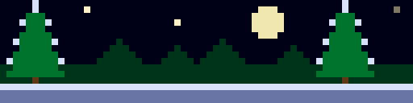

# led-matrix – Surplife-LED-Matrix 64×16 ohne App

🇬🇧 [English version](README.en.md)

Eine Alternative zur **Surplife-App**: Ein Raspberry Pi lädt eigene Animationen per Bluetooth
in eine Surplife-LED-Matrix (64×16 Pixel, Gerätename `IOTBT…`), wechselt sie nach Plan, schaltet
die Anzeige nach Zeitplan ein und aus und passt die Helligkeit dem Tageslicht an. Dazu gehören
rund 40 selbst gezeichnete Weihnachts-, Winter- und Silvester-Animationen.

**Verwandte Projekte**, ohne die das hier nicht entstanden wäre:

- [ge0rg/surplife-curtain](https://codeberg.org/ge0rg/surplife-curtain) – Protokoll des
  Surplife-LED-Vorhangs; diese Matrix spricht dasselbe Protokoll.
- [lambdafu/surplife](https://github.com/lambdafu/surplife) – die Bildkompression „a2pl“
  (`pi/a2pl.py` stammt von dort, MIT-Lizenz).
- [dsalaj/surplife-matrix-ble](https://github.com/dsalaj/surplife-matrix-ble) – Steuerung der
  90×12-Panels; deren Upload-Befehle versteht die 64×16-Matrix allerdings nicht.


---

## Inhalt

1. [Was es kann](#was-es-kann)
2. [Hardware](#hardware)
3. [Schnellstart](#schnellstart)
4. [Wie es arbeitet](#wie-es-arbeitet)
5. [Parameter anpassen](#parameter-anpassen)
6. [Wechselplan](#wechselplan)
7. [Animationen](#animationen)
8. [Eigene Animationen](#eigene-animationen)
9. [Nächste Saison vorbereiten](#nächste-saison-vorbereiten)
10. [Protokoll der Matrix](#protokoll-der-matrix)
11. [Grenzen und Stolperfallen](#grenzen-und-stolperfallen)
12. [Fehlersuche](#fehlersuche)
13. [Programme im Überblick](#programme-im-überblick)
14. [Tests](#tests)
15. [Lizenz](#lizenz)

---

## Was es kann

- **Upload ohne App** – GIF (64×16) → Matrix. Die Matrix speichert die Animation und spielt sie
  selbst ab, auch nach einem Stromausfall.
- **Wächter-Dienst** (`matrix-waechter`) – sucht die Matrix alle 30 s, lädt nur hoch, wenn sich
  etwas geändert hat (Animation, Tempo, Helligkeit), wiederholt bei Fehlern mit wachsender Pause.
- **Wechsel nach Plan** – Animationen in Phasen (vor dem Advent, Adventswochen, Weihnachten,
  Silvester), Wechsel alle 30 Minuten; ein Planer verteilt sie nur auf Zeiten, in denen die Matrix
  an ist. Ein Phasenbeginn kann sekundengenau sein (Neujahrsgruß kurz vor 0 Uhr).
- **Zeitplan** – morgens und ab einer halben Stunde vor Sonnenuntergang (für den eigenen Ort
  berechnet), Zusatzfenster (Silvester bis 1 Uhr) und ein Saisonende. Geschaltet wird über eine
  **Schaltsteckdose (optional)** oder, ohne Steckdose, **per Bluetooth** (Anzeige an/aus).
- **Helligkeit nach Tageslicht** – hell zwischen Sonnenaufgang und kurz nach Sonnenuntergang,
  sonst gedimmt.
- **Adventskalender** – wird jede Nacht neu erzeugt („NOCH 31 TAGE BIS WEIHNACHTEN“).
- **Jahreszahlen und Termine automatisch** – Adventssonntage, Silvester, Neujahrsgruß mit der
  richtigen Jahreszahl.
- **Vorrat** – Animationen werden im Voraus komprimiert; ein Upload ist dann nur Verbinden +
  Übertragen (je nach Größe 15–40 s).
- **Demo-Modus** – viele Animationen nacheinander über eine Verbindung.

## Hardware

| Teil | Hinweis |
|---|---|
| Surplife-LED-Matrix 64×16 | Bluetooth-Name `IOTBT…`, Steuerkästchen mit Taster |
| Raspberry Pi | getestet: Pi 4 mit Raspberry Pi OS (Debian 12), BlueZ, Python 3.11 |
| Schaltsteckdose (**optional**) | per HTTP schaltbar: `GET http://<ip>/ein` und `/aus`; die Startseite enthält eine Zeile `PIN Status : … ein|aus` |

**Bluetooth-Empfang** – beim Pi 4 teilen sich WLAN und Bluetooth Chip und Antenne:

- WLAN auf **5 GHz** stellen (auf 2,4 GHz scheiterte der Verbindungsaufbau dutzendfach):
  `nmcli con modify <verbindung> 802-11-wireless.band a`
- Die Antenne liegt an der Platinenkante beim USB-C-Anschluss – diese Kante zur Matrix bzw. zu
  ihrem Steuerkästchen drehen (brachte im Test 6 dB). Nicht hinter Metall stellen.
- Signal besser als etwa −90 dBm anstreben; −85 dBm und besser ist entspannt.

## Schnellstart

1. Raspberry Pi OS installieren, SSH einschalten, WLAN möglichst auf 5 GHz.
2. Repository auf den Pi kopieren und einrichten:
   ```bash
   git clone https://github.com/<konto>/led-matrix.git
   cd led-matrix/pi && sudo ./installieren.sh
   ```
   Das Skript aktualisiert die Pakete, legt `/opt/matrix` mit Python-Umgebung (bleak, Pillow)
   an, installiert Programme, Animationen und systemd-Dienste, erzeugt den Adventskalender und
   sucht nach der Matrix. Bericht: `/opt/matrix/einrichtung.log`.
3. **Surplife-App schließen** – die Matrix nimmt nur eine Verbindung an.
4. Einstellungen anpassen: `sudo nano /etc/default/matrix-waechter` (mindestens den Ort, siehe
   [Parameter anpassen](#parameter-anpassen); Steckdose nur, wenn vorhanden).
5. Test-Upload:
   ```bash
   cd /opt/matrix && .venv/bin/python matrix_upload.py gifs/schneemann_64x16.gif
   ```
6. Dienste einschalten:
   ```bash
   sudo systemctl enable --now matrix-waechter
   sudo systemctl enable --now matrix-zeitplan.timer   # nur mit Schaltsteckdose nötig
   ```
   Mitlesen: `journalctl -u matrix-waechter -f`

## Wie es arbeitet

```
            alle 30 s                    bei Änderung
 Wächter ──────────────► Matrix suchen ──────────────► verbinden → hochladen → merken
    │                         │
    │  Plan: welches GIF?     │  ohne Steckdose: Anzeige an/aus nach Zeitplan (Bluetooth)
    │  Helligkeit: Tag/Nacht  │
    ▼                         ▼
 /etc/default/matrix-waechter      /var/lib/matrix-waechter/stand (was ist drin)

 Zeitplan-Timer (jede Minute, nur mit Steckdose): Soll-Zustand → Steckdose ein/aus
 Adventskalender-Timer (00:05): Kalender für heute erzeugen und komprimieren
```

- Der **Stand** (`/var/lib/matrix-waechter/stand`) enthält Name der Matrix, Prüfsumme des GIFs,
  Tempo und Helligkeit. Weicht der Soll-Stand ab, wird hochgeladen – sonst nicht. So wird der
  Speicher der Matrix nur bei echten Änderungen beschrieben.
- **Neustart über die Steckdose** (falls vorhanden): nach drei gescheiterten Uploads in Folge
  schaltet der Wächter die Matrix 10 s stromlos, höchstens einmal je 15 Minuten.
- **Phasenbeginn** mit Sekunden: Der Wächter wacht rechtzeitig auf, sucht die Matrix und wartet
  bis zur Sekunde, dann lädt er hoch.

## Parameter anpassen

Fast alles steht in `/etc/default/matrix-waechter` (Vorlage: `pi/matrix-waechter.default`).
Nach Änderungen gilt:

- **Zeitplan-Werte** (`MATRIX_ZEITPLAN_…`, Ort, Ende): der Zeitplan-Timer liest sie jede Minute
  neu; den Wächter trotzdem neu starten, damit auch die Bluetooth-Schaltung sie übernimmt.
- **Alles andere**: `sudo systemctl restart matrix-waechter`.

| Was | Variable(n) | Beispiel / Bedeutung |
|---|---|---|
| Name der Matrix | `MATRIX_NAME` | `IOTBT1A2`; leer = erste gefundene Matrix |
| **Betriebszeit morgens** | `MATRIX_ZEITPLAN_MORGEN` | `06:30-08:30`; leer = morgens aus |
| **Betriebszeit abends** | `MATRIX_ZEITPLAN_ABEND_VOR`, `MATRIX_ZEITPLAN_ABEND_BIS` | `30` (Minuten vor Sonnenuntergang) bis `21:30`; `ABEND_BIS` leer = abends aus |
| Sondertage | `MATRIX_ZEITPLAN_EXTRA` | `2026-12-31T21:30/2027-01-01T01:00` – zusätzlich an; mehrere mit Leerzeichen trennen |
| Saisonende | `MATRIX_ENDE` | `2027-01-01 01:00` – danach bleibt die Anzeige aus, der Wächter ruht |
| **Ort** | `MATRIX_BREITE`, `MATRIX_LAENGE`, `MATRIX_ZEITZONE` | Breite/Länge in Grad, z. B. `47.995` / `7.849`, `Europe/Berlin` |
| Helligkeit nach Tageslicht | `MATRIX_HELL_TAG`, `MATRIX_HELL_NACHT`, `MATRIX_HELL_NACH_UNTERGANG` | `100` / `67` / `30` (Minuten nach Sonnenuntergang wird gedimmt) |
| feste Helligkeit | `MATRIX_HELL` | `67` – gilt, wenn `MATRIX_HELL_TAG` leer ist |
| Tempo | `MATRIX_TEMPO` | `75` (1–75, Wert der App) |
| Schaltsteckdose (optional) | `MATRIX_STECKDOSE` | `http://192.0.2.10`; leer = keine (dann Bluetooth-Schaltung) |
| Neustart über Steckdose | `MATRIX_NEUSTART_NACH`, `MATRIX_AUS_SEKUNDEN`, `MATRIX_NEUSTART_ABSTAND` | `3` Fehlschläge, `10` s aus, höchstens alle `900` s |
| Größengrenze | `MATRIX_MAX_BYTES` | `78000` – größere Animationen werden nicht hochgeladen (siehe [Grenzen](#grenzen-und-stolperfallen)) |
| Suche | `MATRIX_SCAN_ABSTAND`, `MATRIX_PAUSE_MAX` | `30` s zwischen Suchen, bei Fehlern bis `600` s |
| Wechselplan | `MATRIX_GIF_WECHSEL`, `MATRIX_GIFS…` | vom Planer erzeugt, siehe [Wechselplan](#wechselplan) |

**Zeitplan prüfen** (zeigt Sonnenzeiten, Ein-Zeiten und Helligkeit der nächsten Tage):

```bash
set -a; . /etc/default/matrix-waechter; set +a
python3 /opt/matrix/matrix_zeitplan.py plan 7
```

**Beispiele**

- Abends länger an, bis 22:30: `MATRIX_ZEITPLAN_ABEND_BIS=22:30`
- Morgens gar nicht: `MATRIX_ZEITPLAN_MORGEN=`
- Immer mit voller Helligkeit: `MATRIX_HELL_TAG=` und `MATRIX_HELL=100`
- Silvester bis 2 Uhr: `MATRIX_ZEITPLAN_EXTRA="2026-12-31T21:30/2027-01-01T02:00"` und
  `MATRIX_ENDE="2027-01-01 02:00"`

Ändert man die Betriebszeiten deutlich, auch den [Wechselplan](#wechselplan) neu erzeugen – er
legt Animationen nur auf Zeiten, in denen die Matrix an ist.

### Ohne Schaltsteckdose

Die Steckdose ist **optional**. Ohne sie (`MATRIX_STECKDOSE=` leer):

- Hochladen, Wechsel nach Plan und Helligkeit funktionieren genauso.
- Der Wächter schaltet die **Anzeige per Bluetooth** nach demselben Zeitplan ein und aus
  (`71 23` / `71 24`). Die Animation bleibt gespeichert, nur die LEDs gehen aus. Weil schon das
  Verbinden die Anzeige einschaltet, schaltet er sie nach einem Upload außerhalb der
  Betriebszeit gleich wieder aus. Von Hand: `matrix_anzeige.py an|aus` (Wächter vorher anhalten).
- Es fehlt nur der Strom-Neustart bei hängender Matrix.
- `matrix-zeitplan.timer` braucht man nicht (er tut ohne Steckdose nichts).

## Wechselplan

Welche Animation wann läuft, erzeugt `pi/plan_erzeugen.py`:

- ein Platz je halbe Stunde, Phasen mit eigenem Beginn:
  1. eine Woche vor dem 1. Advent – allgemeine Winter-Animationen,
  2. bis 5. vier Adventswochen – jeweils mit dem passenden Adventskranz (Sonntag früh und
     Sonntagabend zu jeder vollen Stunde, Mittwoch und Freitag 18 Uhr), Adventskalender täglich
     17 Uhr, Nikolaus am 6.12.,
  6. ab 25.12. – Animationen mit Weihnachtsgrüßen,
  7. ab 27.12. – Silvester (am 31.12. um 23 Uhr Feuerwerk, 23:30 Countdown),
  8. am 31.12. um 23:59:18 – Neujahrsgruß, sekundengenau, damit er um Mitternacht läuft;
- Animationen nur auf Plätze, in denen die Matrix an ist; nie zweimal hintereinander;
- Adventssonntage, Silvester, Saisonende und Zusatzfenster werden aus dem Jahr berechnet.

```bash
python3 pi/plan_erzeugen.py            # schreibt den Plan in pi/matrix-waechter.default
python3 pi/plan_erzeugen.py --zeigen   # zeigt, was wann läuft
```

Danach in `/etc/default/matrix-waechter` die Zeilen `MATRIX_GIF_WECHSEL`, `MATRIX_GIFS…`,
`MATRIX_ZEITPLAN_EXTRA` und `MATRIX_ENDE` durch die neuen ersetzen und den Wächter neu starten.
Listen, feste Plätze und Takt stehen am Anfang von `plan_erzeugen.py` (`ALLGEMEIN`,
`ADVENT_EXTRA`, `WEIHNACHTEN`, `SILVESTER`, `fest()`, `SCHRITT`).

## Animationen

Alle 64×16, je 255 Bilder, komprimiert höchstens 76 KB; 8-fach vergrößerte Vorschau in
`vorschau/`.

| Animation | Gruppe | Inhalt | KB |
|---|---|---|---|
| `kamin` | Winter | Kaminfeuer, Strümpfe, Fenster mit Schnee, Tannenbaum | 71.7 |
| `schlittenflug` | Winter | Weihnachtsmann mit Rentieren über dem Dorf, Geschenke fallen in die Kamine | 73.5 |
| `polarlicht` | Winter | Nordlicht über Bergen und Hütte | 72.6 |
| `lebkuchen` | Winter | Lebkuchenhaus, Eiszapfen, Lebkuchenmann, Zuckerstangen | 74.0 |
| `zug` | Winter | Weihnachtszug mit Dampflok, Baum, Geschenken und Schneemann, „TUUT“ | 73.7 |
| `glocken` | Winter | schwingende Glocken, Noten, „KLING GLOECKCHEN …“ | 70.8 |
| `pinguine` | Winter | Pinguine mit Mützen, Bauchrutscher, Schneeball | 73.5 |
| `rentier` | Winter | Rudolph mit leuchtender Nase, „RUDOLPH“ | 73.7 |
| `schneeflocken` | Winter | wachsende, drehende Eiskristalle | 73.6 |
| `eislaufen` | Winter | Eisläufer auf dem See, Laternen, Lichterkette | 73.5 |
| `weihnachtsmarkt` | Winter | Buden, Karussell, Glühweinkessel, Leute | 73.1 |
| `lichterhaus` | Winter | Haus wird Licht für Licht geschmückt, Leucht-Rentier | 72.5 |
| `baum_schmuecken` | Winter | Lichterkette, Kugeln, Lametta, Stern, Geschenke | 73.3 |
| `schneeballschlacht` | Winter | Schneeballschlacht, Schneeengel | 67.4 |
| `rodeln` | Winter | Kinder rodeln und stapfen wieder hinauf | 73.1 |
| `futterhaus` | Winter | Meise, Rotkehlchen, Gimpel, Kohlmeise am Vogelhaus | 73.2 |
| `winterwald` | Winter | Reh und Fuchs im Winterwald | 72.9 |
| `bratapfel` | Winter | Bratapfel im Ofen, Kakao mit Sahne und Marshmallows | 73.2 |
| `stadt_schnee` | Winter | Stadt wird weiß, Fenster gehen an, Kirche, Baum | 73.5 |
| `weihnachtsmann_rentier` | Winter | Weihnachtsmann und Rentier (50 Bilder) | 9.0 |
| `auspacken` | Geschenke | Geschenk auspacken: Teddy, Spielzeugzug, Stern | 47.7 |
| `werkstatt` | Geschenke | Wichtel am Fließband, Stempel | 71.5 |
| `geschenkeberg` | Geschenke | Pakete stapeln sich unter dem Baum | 70.1 |
| `wunschzettel` | Geschenke | Briefe fliegen zum Nordpol-Briefkasten | 70.5 |
| `plaetzchen` | Geschenke | Plätzchen ausrollen, ausstechen, backen, verzieren | 68.9 |
| `advent1` | Advent | Adventskranz 1. Advent: Kerzen fallen ein, eine wird angezündet | 63.2 |
| `advent2` | Advent | Adventskranz 2. Advent (zwei Kerzen) | 67.7 |
| `advent3` | Advent | Adventskranz 3. Advent (drei Kerzen) | 69.3 |
| `advent4` | Advent | Adventskranz 4. Advent (vier Kerzen) | 65.9 |
| `adventskalender` | Advent | Türchen mit Tagen bis Heiligabend, Motiv, Laufschrift – täglich neu | 65.5 |
| `nikolaus` | Advent | Nikolaus winkt und füllt die Stiefel (6.12.) | 73.1 |
| `krippe` | Weihnachten | Stern von Bethlehem, Stall, drei Könige | 73.4 |
| `hirten` | Weihnachten | Hirten, Engel im Licht, Stern | 72.1 |
| `stille_nacht` | Weihnachten | Kind in der Krippe, Kerzen, „STILLE“ / „NACHT“ | 71.8 |
| `weihnacht_bunt` | Weihnachten | Tannen, „FROHE WEIHNACHTEN“, Geschenke, Lichterkette (ab 25.12.) | 66.1 |
| `hohoho` | Weihnachten | HO HO HO, Zuckerstangen-Rahmen, „FROHE WEIHNACHTEN“ (ab 25.12.) | 69.7 |
| `schneemann` | Weihnachten | Schneemann wird gebaut, Rotkehlchen, „FROHES FEST“ (ab 25.12.) | 72.8 |
| `feuerwerk` | Silvester | Feuerwerk über der Stadt, Jahreszahl aus Funken | 69.5 |
| `countdown` | Silvester | 10 … 0, „PROSIT NEUJAHR“ | 44.0 |
| `sekt` | Silvester | Korken knallt, Gläser stoßen an, „PROST“ | 44.0 |
| `gluecksbringer` | Silvester | Kleeblatt, Hufeisen, Glücksschwein, Schornsteinfeger, „VIEL GLÜCK“ | 71.9 |
| `jahreswechsel` | Silvester | alte Jahreszahl rollt auf die neue | 68.2 |
| `neujahr_2027` | Silvester | „ALLES GUTE“ / „FÜR“ / Jahreszahl mit Feuerwerk (31.12. um 0 Uhr) | 68.2 |


| | | |
|---|---|---|
|  |  |  |
|  |  |  |

## Eigene Animationen

Jede Animation ist ein Python-Modul in `animationen/` mit `NAME`, `TITEL` und `bilder()`, das
eine Liste von `Bild`-Objekten liefert. Bausteine in `basis.py`: `setze`, `rechteck`, `linie`,
`kreis`, `figur` (Pixel-Figuren aus Zeichenketten), `text` (5×7-Schrift, vergrößerbar), Schnee,
Sterne, Farben, `NEUES_JAHR`.

```python
from basis import B, ROT, Bild, Schnee

NAME = "mein_motiv"
TITEL = "Roter Ball im Schnee"
SCHNEE = Schnee()

def bilder():
    liste = []
    for f in range(255):
        bild = Bild()
        SCHNEE.zeichnen(bild, f)
        bild.kreis(f % B, 8, 2, ROT)
        liste.append(bild)
    return liste
```

```bash
python3 animationen/erzeugen.py mein_motiv --bogen   # GIF, Vorschau und Bildbogen zum Ansehen
python3 animationen/groesse.py mein_motiv            # komprimierte Größe prüfen
```

Neue Module in `ANIMATIONEN` in `erzeugen.py` und in eine Liste in `plan_erzeugen.py` eintragen.

**Worauf achten**

- **Größe**: komprimiert höchstens ~76 KB (die Matrix speichert nur 80 KB). Jedes Bild wird
  einzeln komprimiert – ein detailreicher, stillstehender Hintergrund kostet in allen 255 Bildern.
  Günstig sind große einfarbige Flächen, lange senkrechte Läufe gleicher Farbe und ruhiger dunkler
  Hintergrund; teuer sind Rauschen, Funkeln überall, Schnee über die ganze Fläche, Verläufe und
  viele Einzelpixel. Im Mittel bleiben etwa 300 Bytes je Bild.
- **Farben**: nur 32 Helligkeitsstufen – sehr dunkle Töne sind auf den LEDs aus, Schwarz-Grau
  verschwindet. Kräftige Farben und klare Umrisse wirken am besten.
- **Bildzahl**: höchstens 255. `basis.speichern` sorgt dafür, dass gleiche aufeinanderfolgende
  Bilder nicht zusammengelegt werden (die Matrix spielt im festen Takt, Standbilder würden sonst
  zu kurz).

## Nächste Saison vorbereiten

Alle Termine und Jahreszahlen entstehen aus dem Jahr (ab Juli gilt die kommende Saison;
`MATRIX_JAHR=2028` erzwingt ein Jahr):

1. Silvester-Animationen mit neuer Jahreszahl erzeugen und prüfen:
   ```bash
   python3 animationen/erzeugen.py feuerwerk jahreswechsel neujahr_2027
   python3 animationen/groesse.py
   ```
   (Das Modul heißt `neujahr_2027.py`, das GIF heißt dann `neujahr_<Jahr>_64x16.gif`.)
2. Plan erzeugen: `python3 pi/plan_erzeugen.py`.
3. GIFs nach `/opt/matrix/gifs` kopieren, Vorrat anlegen
   (`/opt/matrix/.venv/bin/python /opt/matrix/matrix_upload.py --vorrat /opt/matrix/gifs/*_64x16.gif`),
   Plan-Zeilen in `/etc/default/matrix-waechter` ersetzen, Dienste einschalten.

## Protokoll der Matrix

Ermittelt aus einem Bluetooth-Mitschnitt der iPhone-App (PacketLogger) und dem
surplife-curtain-Protokoll; umgesetzt in `pi/matrix_spieler.py` und `pi/matrix_upload.py`.

**Verbindung**: GATT-Dienst `ffff`, schreiben auf `ff01`, Meldungen auf `ff02`.
Paket: `[01][seq][80 00][Länge-1 BE16][Länge BE16][0a][Befehl]`; Antworten beginnen mit `05`.
Handschlag: `0c`, Uhrzeit `10 14 …` mit Prüfsumme, Statusabfrage `ea 81 8a 8b 59` (die Antwort
enthält u. a. die LED-Zahl 1024), Anzeige an `71 23` (aus: `71 24`).

**Farben**: 16 Bit je Pixel – Farbton 7 Bit, Sättigung 4 Bit, Helligkeit 5 Bit (big-endian).
Rot = `01FF`, Weiß = `001F`.

**Animation hochladen**:

| Befehl | Inhalt |
|---|---|
| `ea 01` + 38 Bytes | Kopf, Bildanzahl an Byte 21–22 (BE) |
| `ea 02` + je Bild 6 Bytes | Tabelle: Position (u32 BE) und Länge (u16 BE) jedes komprimierten Bildes |
| `ea 03 NNNN` + Daten | ein Bild (ab 1 gezählt): 1024 Pixel × 2 Bytes **spaltenweise** (x·16 + y), a2pl-komprimiert |
| `ea 04 00` | Ende |
| `e2 09 01 TEMPO HELL 00` | Tempo (App: 75) und Helligkeit (0–100) |

Die Matrix quittiert jeden Schritt (`15 ea 01 00`, `15 ea 02 00`, `15 ea 03 00 NN`,
`15 ea 04 00`). Befehle über 509 Bytes werden gestückelt (Paketkopf `41`, Stücknummer mit Bit 15
beim letzten). Die Bilddauer aus dem GIF wird nicht übertragen – die Matrix spielt im festen Takt.

**Live-Zeichnen** geht auch (`e2 0b HSV` füllt alles, `e2 0c 90 HSV Maske` setzt Pixel einer
Farbe), schafft aber nur 3–7 Befehle pro Sekunde – für Animationen zu langsam.

## Grenzen und Stolperfallen

Gemessen an einer Matrix (Firmware unbekannt):

- **Speicher 80 KB**: Die Matrix speichert je Animation höchstens 80 KB (81 920 Bytes)
  komprimierte Daten. Was darüber liegt, geht verloren – am Ende jeder Runde fehlt dann zuerst
  der linke Bildteil (die Daten liegen spaltenweise von links). Gemessen: 78 444 Bytes fehlerfrei,
  84 788 Bytes kurz am Rundenende kaputt, ab 94 000 Bytes deutlich. Bei 254 KB war die Animation
  zerstört und die Matrix per Bluetooth nicht mehr erreichbar, bis über die App eine andere
  geladen wurde. Deshalb lädt der Wächter nichts über 78 000 Bytes hoch.
- **Höchstens 255 Bilder** je Animation; ab 256 bricht die Matrix beim Hochladen ab.
- **Nur eine Verbindung**: Ist die App (oder ein anderes Gerät) verbunden, ist die Matrix für den
  Pi unsichtbar – auch nach einem Stromneustart verbindet sich das Telefon oft sofort wieder. Unter
  iOS kann man der App in den Datenschutz-Einstellungen den Bluetooth-Zugriff entziehen.
- **Dauer**: grob 0,06 s je Bild plus 0,2–0,3 s je KB, plus ~6 s Verbinden; während des Uploads
  steht die alte Animation.
- **BlueZ** hält nach abgebrochenen Programmen manchmal Verbindungen offen; der Wächter trennt sie
  beim Start (`bluetoothctl disconnect <adresse>`).
- **Flash**: Jeder Upload schreibt den Speicher der Matrix neu. Bei ~17 Wechseln am Tag in einer
  Saison sind das einige hundert Schreibvorgänge – für übliches Flash unbedenklich; der verbaute
  Baustein ist aber nicht bekannt.

## Fehlersuche

| Problem | Abhilfe |
|---|---|
| Matrix wird nicht gefunden | App geschlossen? Bluetooth am Telefon aus? Matrix hat Strom? `bluetoothctl disconnect <adresse>` |
| Einzelne LEDs an, Matrix nicht erreichbar | kaputte (zu große) Animation: über die App eine Standard-Animation laden, dann `sudo rm /var/lib/matrix-waechter/stand && sudo systemctl restart matrix-waechter` |
| Teil des Bildes fällt am Rundenende aus | Animation zu groß: `animationen/groesse.py` prüfen, verkleinern |
| Upload bricht ab | Signal prüfen (besser als −90 dBm), WLAN auf 5 GHz, Pi näher bzw. Antennenkante zur Matrix |
| Wächter lädt nicht neu | `sudo rm /var/lib/matrix-waechter/stand && sudo systemctl restart matrix-waechter` |
| Zeiten stimmen nicht | Ort und Zeitzone prüfen, `matrix_zeitplan.py plan 7` |
| Log | `journalctl -u matrix-waechter -f`, `journalctl -u matrix-zeitplan` (nur wenn geschaltet wurde), nur Warnungen `journalctl -p warning` |

## Programme im Überblick

| Datei | Aufgabe |
|---|---|
| `pi/matrix_upload.py` | GIF hochladen (`matrix_upload.py [--tempo 75] [--hell 100] GIF`), Vorrat anlegen (`--vorrat GIF …`) |
| `pi/matrix_waechter.py` | Dienst: suchen, bei Änderung hochladen, Phasen und Wechsel, Helligkeit, Bluetooth-Schaltung ohne Steckdose, Neustart über Steckdose |
| `pi/matrix_zeitplan.py` | Zeitplan und Sonnenzeiten; schaltet die Steckdose (Timer jede Minute); `plan N` zeigt die Zeiten |
| `pi/plan_erzeugen.py` | erzeugt den Wechselplan |
| `pi/matrix_anzeige.py` | Anzeige per Bluetooth an/aus |
| `pi/matrix_demo.py` | Demo: viele Animationen nacheinander |
| `pi/matrix_spieler.py` | Verbindung, Handschlag, Live-Zeichnen (zum Testen) |
| `pi/a2pl.py` | Kompression (aus lambdafu/surplife, MIT) |
| `pi/installieren.sh` | Einrichtung auf dem Pi |
| `pi/*.service`, `pi/*.timer` | systemd: Wächter, Zeitplan, Adventskalender |
| `pi/matrix-waechter.default` | Vorlage für `/etc/default/matrix-waechter` |
| `animationen/` | Animationen als Python-Module; `erzeugen.py` schreibt die GIFs, `groesse.py` misst |

## Tests

Ohne Bluetooth, u. a. gegen die Bytes aus dem App-Mitschnitt:

```bash
python3 -m unittest pi/test_matrix.py
```

## Lizenz

MIT, siehe [`LICENSE`](LICENSE). `pi/a2pl.py` stammt aus
[lambdafu/surplife](https://github.com/lambdafu/surplife) (ebenfalls MIT, Hinweis in der Datei).
